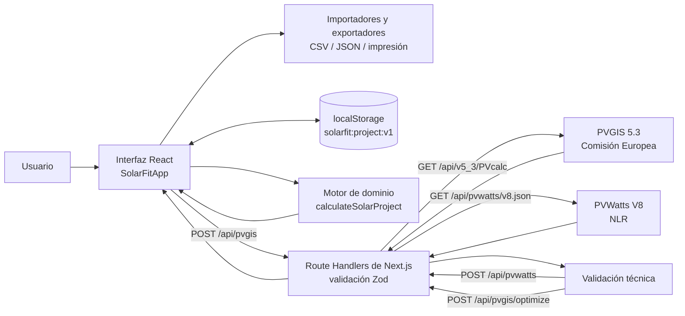

# Arquitectura técnica

## 1. Propósito arquitectónico

SolarFit Hogar separa la captura y presentación de datos del cálculo matemático. La decisión permite comprobar las fórmulas sin montar la interfaz, sustituir una fuente solar sin reescribir el dominio y mantener visibles la procedencia y las limitaciones de cada resultado.

La aplicación es un prototipo web de una sola vivienda por borrador. No hay autenticación, base de datos, panel administrativo, pagos ni servicios de instalación.

## 2. Vista general



## 3. Componentes y responsabilidades

| Capa | Archivos principales | Responsabilidad |
|---|---|---|
| Presentación | `src/app/page.tsx`, `src/app/globals.css` | Página pública, navegación, explicación del producto y estilos |
| Interacción | `src/components/solar-fit-app.tsx` | Estado del formulario, flujo Datos–Modelo–Resultados, consulta PVGIS y exportaciones |
| Visualización | `src/components/charts.tsx` | Gráficos SVG de consumo/producción y sensibilidad |
| Dominio | `src/domain/solar/calculate.ts` | Validación numérica, dimensionamiento, restricción de techo, resultados y advertencias |
| Análisis | `src/domain/solar/analysis.ts`, `optimization.ts` | Métricas entre series, sensibilidad y optimización discreta con diferencias finitas |
| Facturación | `src/domain/solar/bills.ts` | Prorrateo diario de periodos de factura que atraviesan meses |
| Tipos | `src/domain/solar/types.ts` | Contratos de entrada, salida, procedencia y errores del modelo |
| Fuente solar | `src/services/solar-yield.ts`, `pvgis.ts`, `pvwatts.ts`, `pvgis-optimization.ts` | Contrato común, normalización de energía neta, proveedores y comparación de inclinaciones |
| API | `src/app/api/pvgis/`, `src/app/api/pvwatts/` | Fronteras de servidor, validación Zod y traducción de errores a HTTP |
| Persistencia local | `src/lib/project-storage.ts` | Lectura, escritura y eliminación del borrador en el navegador |
| Intercambio | `src/lib/monthly-csv.ts`, `src/lib/downloads.ts` | Importación mensual y descarga de plantilla, resultados y proyecto |
| Datos de inicio | `src/data/demo-project.ts` | Escenario sintético rotulado y estructura vacía para datos reales |
| Verificación | `src/domain/solar/*.test.ts` | Pruebas unitarias del cálculo, sensibilidad, métricas y prorrateo |

## 4. Fronteras de cliente y servidor

### Navegador

`SolarFitApp` es un componente cliente. Mantiene el proyecto en memoria, calcula resultados con funciones puras, lee CSV y proyectos JSON elegidos por el usuario, descarga archivos y guarda el borrador en `localStorage`.

El cálculo manual y la consulta de resultados no requieren enviar consumos ni datos del panel a un servidor. La aplicación no implementa analítica ni telemetría.

### Servidor Next.js

Las rutas base de rendimiento, `POST /api/pvgis` y `POST /api/pvwatts`, reciben solamente:

- latitud y longitud;
- inclinación;
- azimut de brújula;
- porcentaje de pérdidas.

Zod valida límites antes de invocar un adaptador. El servidor traduce el azimut de brújula al convenio de PVGIS y realiza los `GET` externos. Esta capa es necesaria porque la documentación oficial de PVGIS informa que las solicitudes AJAX directas desde el navegador están bloqueadas por CORS; también evita exponer la clave opcional de PVWatts al cliente.

### Servicio externo

El adaptador principal usa:

```text
https://re.jrc.ec.europa.eu/api/v5_3/PVcalc
```

Configuración fija actual:

- potencia normalizada: `peakpower=1` kW;
- tecnología: `pvtechchoice=crystSi`;
- montaje: `mountingplace=building`;
- horizonte topográfico: `usehorizon=1`;
- salida: JSON.

El servidor no fija una base meteorológica para PVGIS; el proveedor elige la recomendada y el nombre recibido se conserva en la procedencia.

El adaptador opcional de PVWatts usa `https://developer.nlr.gov/api/pvwatts/v8.json`, normaliza un sistema de 1 kWp, fija módulo estándar, techo fijo, datos mensuales y `dataset=nsrdb`. Requiere `NLR_API_KEY` en el entorno de servidor. La implementación envía la clave mediante el encabezado `X-Api-Key`, nunca en la URL, y usa `cache: no-store`. La ruta devuelve 503 si la clave no está configurada.

Cada intento PVWatts tiene un límite de 12 segundos. Para 429 o 5xx realiza hasta tres intentos, con esperas aproximadas de 500 y 1.000 ms; también trata como error los mensajes incluidos por el proveedor en `errors[]`.

`POST /api/pvgis/optimize` acepta entre 2 y 13 inclinaciones únicas, consulta PVGIS para cada una, conserva respuestas válidas, selecciona el mayor rendimiento anual y estima derivadas primera y segunda mediante diferencias finitas. La interfaz ofrece controles para ejecutar la optimización, aplicar la serie seleccionada y contrastar el modelo actual con PVWatts.

## 5. Flujo principal de datos

1. La aplicación inicia con `DEMO_PROJECT` o recupera `solarfit:project:v1` del navegador.
2. Cada cambio crea un nuevo objeto de proyecto en el estado de React.
3. `calculateSolarProject` se ejecuta de manera derivada con el proyecto completo.
4. Si una entrada no es válida, el dominio produce `SolarModelError`; la interfaz muestra el mensaje y no presenta una recomendación.
5. Si es válida, el resultado se muestra en el resumen, las métricas, gráficos y tabla mensual.
6. Al cambiar entradas, el borrador se vuelve a guardar localmente.
7. Una exportación crea el archivo en el navegador; no lo carga a un servidor.

### Flujo PVGIS

1. El usuario selecciona **Rendimiento neto PVGIS** y proporciona coordenadas y configuración.
2. La interfaz envía el contrato interno a `/api/pvgis`.
3. La API rechaza parámetros fuera de rango con HTTP 400.
4. El adaptador consulta PVGIS con un tiempo máximo de 10 segundos por intento.
5. Una cola por instancia separa los inicios de consulta PVGIS por al menos 75 ms. Para HTTP 429, 529 o 5xx reintenta hasta tres veces, con esperas aproximadas de 350 y 700 ms.
6. Verifica que existan doce meses únicos y que las magnitudes sean finitas y no negativas.
7. Devuelve `E_m` como kWh/kWp mensual y registra proveedor, versión, base, fecha, fuente y advertencias.
8. La interfaz cambia al modo `pvgis-yield`. El motor usa esos valores sin multiplicar nuevamente por PR.

La solicitud externa de PVGIS usa una revalidación de 86.400 segundos. La respuesta de su ruta al navegador se marca como privada y exige revalidación. PVWatts y la optimización se marcan `private, no-store`.

## 6. Decisiones de diseño

### 6.1 Dos modos solares mutuamente excluyentes

El modo manual aplica `HSP × días × PR`. El modo PVGIS consume producción específica neta. Aplicar ambos factores a la vez duplicaría pérdidas y subestimaría la energía, por lo que `solarSourceMode` obliga a seleccionar una sola ruta.

### 6.2 Solución continua antes de la decisión entera

El dominio conserva `continuousPanelCount` para el análisis de cálculo diferencial. Solo después usa techo matemático para `recommendedPanelCount`. Así la función se puede derivar sin fingir que una función escalonada es suave.

### 6.3 Recomendación y restricción física no se confunden

Si el área es insuficiente, el motor no reduce silenciosamente la recomendación matemática. Conserva:

- `recommendedPanelCount`: lo que exige la meta energética;
- `maximumPanelsByRoof`: lo que admite el área declarada;
- `buildablePanelCount`: el menor de los dos, usado para mostrar la cobertura alcanzable.

### 6.4 Procedencia como parte del proyecto

Consumo, recurso solar y panel tienen un objeto `DataProvenance`. Los tipos posibles son `synthetic`, `user` y `official`. La etiqueta no prueba por sí sola que una fuente sea correcta; el equipo debe conservar el soporte externo.

### 6.5 Privacidad por minimización

La interfaz pide municipio o referencia general, no dirección. No existe sincronización en la nube. Aun así, las coordenadas usadas en PVGIS se transmiten a la Comisión Europea y el JSON exportado puede contenerlas.

## 7. Gestión de errores

| Origen | Comportamiento actual |
|---|---|
| Entrada incompleta o fuera de rango | El motor detiene el resultado y muestra un mensaje asociado al campo |
| CSV incorrecto | Se conserva el proyecto actual y se muestra un error en línea |
| Coordenadas ausentes | No se realiza la consulta PVGIS |
| Parámetros PVGIS inválidos | HTTP 400 con errores por campo |
| PVGIS saturado o con error temporal | Hasta tres intentos para 429, 529 y 5xx |
| Timeout o respuesta inválida | HTTP 502 desde la ruta interna y mensaje al usuario |
| `localStorage` bloqueado | El cálculo continúa en memoria y la interfaz recomienda exportar JSON |
| Borrador corrupto o incompatible | Se descarta de forma segura y se informa; la demostración permanece disponible |
| Configuración solar modificada | Se invalidan la serie PVGIS y las validaciones asociadas hasta volver a consultar |
| Respuesta externa tardía | Un contador de solicitud impide aplicarla sobre un escenario posterior |

## 8. Persistencia y versionado

El borrador se almacena bajo la clave:

```text
solarfit:project:v1
```

La exportación JSON añade `schemaVersion: 1` y `exportedAt`. El mismo esquema Zod valida tanto el borrador como el archivo importado. Una versión distinta de 1 se rechaza explícitamente; un borrador v1 corrupto se elimina para que no bloquee cada inicio. Al importar, la aplicación toma únicamente las entradas validadas y recalcula el resultado: no confía en resultados serializados por un archivo externo.

## 9. Capacidades avanzadas y utilidades de dominio

El flujo visible usa `compareEnergySeries`, `analyzeTiltOptimization`, `/api/pvgis/optimize` y `/api/pvwatts` para la validación avanzada. El repositorio también conserva utilidades que todavía no forman parte del formulario:

- `hspSensitivity`: primera y segunda derivada para un caso explícito;
- `optimizeTilt`: selección entre proyectos candidatos que minimiza paneles continuos;
- `calendarizeBills`: prorrateo de facturas con fechas reales a meses calendario.

Que una ruta o función exista no equivale a que el usuario pueda ejecutarla desde la interfaz. Debe distinguirse entre capacidad técnica del backend, integración visible y validación ya realizada.

## 10. Limitaciones técnicas conocidas

- El optimizador compara una malla discreta de ángulos; no prueba que el máximo continuo no esté entre candidatos.
- El prorrateo de facturas no está conectado al formulario.
- Las coordenadas no se geocodifican ni se verifican contra el texto de ubicación.
- El área se representa como un escalar; no se modelan geometría, pasillos obligatorios ni obstáculos individuales.
- Los resultados se calculan mensualmente y no representan coincidencia horaria entre generación y consumo.
- El CSV identifica en `scenario` si exportó la recomendación energética o la serie limitada por el techo.
- Los endpoints usan control de reintentos y ritmo por instancia, pero no implementan una cuota distribuida por usuario; la versión entregada debe ejecutarse localmente y no exponerse públicamente sin esa capa.

## 11. Despliegue

Una compilación productiva requiere `pnpm install --frozen-lockfile` y `pnpm build`. `pnpm typecheck` ejecuta primero `next typegen`, por lo que también funciona desde una copia limpia. El entorno debe permitir HTTPS saliente hacia `re.jrc.ec.europa.eu` y, si se usa la validación opcional, `developer.nlr.gov`. La única variable secreta prevista es `NLR_API_KEY`; no debe usar el prefijo `NEXT_PUBLIC_`. No hay migraciones de base de datos.

Antes de exponer públicamente la aplicación se recomienda agregar límites por IP a `/api/pvgis`, validación del tamaño del cuerpo, encabezados de seguridad, monitorización sin datos personales y una política de privacidad que describa el envío de coordenadas al tercero.

## 12. Referencias

- [Servicio API no interactivo de PVGIS](https://joint-research-centre.ec.europa.eu/photovoltaic-geographical-information-system-pvgis/using-pvgis-5/api-non-interactive-service_en)
- [Manual oficial de PVGIS 5](https://joint-research-centre.ec.europa.eu/photovoltaic-geographical-information-system-pvgis/using-pvgis-5/pvgis-5-user-manual_en)
- [PVWatts V8 API](https://developer.nlr.gov/docs/solar/pvwatts/v8/)
- Código fuente: `src/` de este repositorio.
